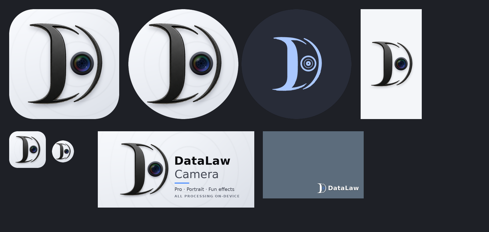

# DataLaw Camera

Камера бренда **DataLaw** на **Capacitor 8** (Android): нативный CameraX, PRO-режим (ISO/выдержка), портрет, смешные эффекты,
серия, фильтры, таймер, водяной знак. Сборка и публикация — GitHub Actions.



## Быстрый старт (VS Code + git)
```bash
git init && git add . && git commit -m "DataLaw Camera"
git branch -M main
git remote add origin https://github.com/<org>/<repo>.git
git push -u origin main
```
GitHub → **Actions → DataLaw Camera — сборка и релиз** → артефакт `DataLaw-Camera-<версия>` → `.apk` на телефон.

## Чтобы приложение ОБНОВЛЯЛОСЬ, а не ставилось новым
Нужны три вещи — все уже настроены:
1. **Тот же `applicationId`** — `com.datalaw.camera` (`capacitor.config.json` ↔ `brand/brand.json`, сверяет `npm run check`).
2. **Та же подпись.** Без секретов CI подписывает постоянным dev-ключом `signing/datalaw-dev.p12`, поэтому сборки обновляются
   поверх друг друга. **Перед публичной раздачей создайте свой ключ:** `npm run keystore` и добавьте 3 секрета
   (`DL_KEYSTORE_BASE64`, `DL_KEYSTORE_PASSWORD`, `DL_KEY_ALIAS`). SHA-256 сертификата печатается в Summary каждого запуска.
3. **Растущий `versionCode`** = `1000 + номер запуска` (автоматически).

## Публикация в Google Play
Пошагово — `store/RELEASE_CHECKLIST.md`. Коротко: ключ → `npm run docs` (политика на GitHub Pages) → Play Console →
`git tag v1.0.0 && git push --tags` → CI собирает **AAB** (+ GitHub Release, + загрузка на internal track при секрете
`PLAY_SERVICE_ACCOUNT_JSON`). Тексты, иконка 512, feature graphic, ответы для Data safety — в `store/`.

## Бренд
- Исходный логотип: `brand/source/logo-original.png`. Иконка (adaptive + themed), сплэш, водяной знак, Play-графика
  генерируются: `pip install pillow numpy scipy && npm run brand` — результат коммитится (`android-res/`, `www/brand/`, `store/`).
- Название, цвета, ссылки, e-mail — `brand/brand.json`. **Замените заглушки** `example.com` / `CHANGE_ME` (CI предупредит,
  а загрузка в Google Play без этого не пройдёт).
- В приложении: загрузочный экран, значок в видоискателе, «О приложении», необязательный водяной знак на фото,
  акцентный цвет DataLaw Blue.

## Что сделано против «зависания при открытии камеры»
- Запуск CameraX разбит на шаги с **тайм-аутами** (ping плагина → разрешения → старт); любой сбой/молчание → автоматический
  откат на режим совместимости (WebView), а не бесконечное ожидание.
- Разрешения запрашиваются отдельным вызовом (без сохранённых колбэков на стороне Java).
- Если прошлый запуск CameraX не завершился (зависание/падение), следующий старт идёт без него и сообщает об этом.
- Дублирующие запуски (возврат из диалога разрешений) отсекаются; тяжёлый конвейер эффектов создаётся только при входе в «Эффекты».
- Загрузочный экран через 7 с показывает кнопку «Режим совместимости»; экран ошибки всегда имеет «Повторить».
- **Настройки → Диагностика** хранит журнал запуска — «Копировать» и пришлите, если что-то не так.

## Структура
```
www/            приложение (HTML/CSS/JS, без сборщика), brand/, version.js (генерируется в CI)
native/         Java: MainActivity, NativeCameraPlugin (CameraX), FunPipeline/FunEffects, MediaSaverPlugin
scripts/        patch-android.mjs (патч платформы), make-keystore.mjs, check-brand.mjs, build-docs.mjs
brand/          логотип, brand.json, build_assets.py        android-res/  сгенерированные ресурсы
signing/        dev-ключ (в git) · реальный ключ НЕ в git     store/ docs/  Google Play и политика
.github/workflows/android.yml
```
`android/` в git не хранится — CI создаёт её командой `cap add android` и патчит `scripts/patch-android.mjs`.

## Требования (Capacitor 8)
Node ≥ 22, JDK 21, Android Studio Otter 2025.2.1+ (если собираете локально), compileSdk/targetSdk 36, minSdk приложения 29.
Локально: `npm install && npm run android:add && npm run android:open`. Отладка интерфейса без телефона: `npm run dev`.

## Известные ограничения
- Нативный Java-код проверен на синтаксис, но в среде разработки не собирался Gradle'ом и не запускался на телефоне —
  первую сборку в Actions и проверку на устройстве выполните вы; при сбое пришлите лог шага или «Диагностику».
- Фильтры в CameraX-режиме не применяются к видео (только превью/фото); водяной знак — только на фото.
- Блокировка портретной ориентации на планшетах/складных обходится временным opt-out Android 16 (в Android 17 исчезнет).
